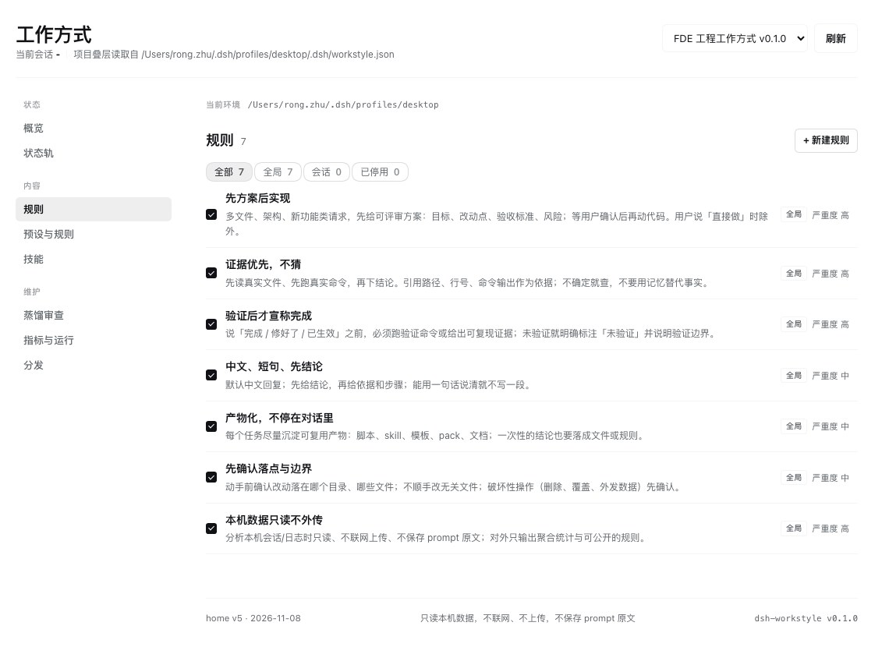
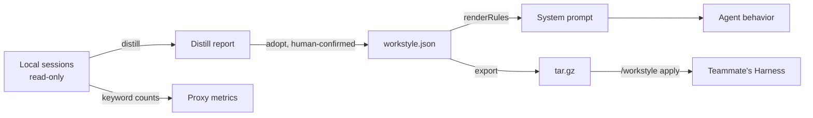

<div align="center">
  
  <h1>dsh-workstyle</h1>

  <p><b>Make DeepSeek Harness agents work like you.</b></p>

  <p><sub>Package your working style as a versioned set of rules, skills and presets, inject it into the system prompt at global, project or session scope, and hand the pack to a teammate as one file.</sub></p>

  <p>
    <a href="LICENSE"></a>
    <a href="package.json"></a>
    
    <a href="https://github.com/iannil/dsh-workstyle"></a>
    <a href="https://github.com/iannil/dsh-workstyle/commits/master"></a>
  </p>

  <p><a href="README.md">English</a> | <a href="README.zh.md">中文</a></p>
</div>



> ⭐ **If this looks useful, [star the repo](https://github.com/iannil/dsh-workstyle)** — it helps other DeepSeek Harness users find it.

## What is this?

Skills decide what an agent *can* do. dsh-workstyle decides *how* it does it.

A workstyle is a reviewable `workstyle.json` pack of rules, skills and presets. Install it and its rules land in the DeepSeek Harness system prompt at global, project or session scope; the panel shows the exact injected text with a `sha256` fingerprint, suggests rules distilled from your local sessions, and reports reproducible metrics for what changed.

## Install

Requires [DeepSeek Harness](https://github.com/deepseek-ai/deepseek-harness). `<profile>` is the directory name under `~/.dsh/profiles/` (for example `desktop`).

```sh
dsh plugin --profile <profile> add github:iannil/dsh-workstyle
```

Restart DeepSeek Harness. A **Workstyle** entry appears in the sidebar.

For local development, install this directory through the plugin manager instead; restart after each JS change.

## Verify in 3 minutes

1. **Open Workstyle** — the status rail shows the injected rule count and a fingerprint; the footer shows `home v5`.
2. **Start a new chat** and ask for something real (for example, "add login to this project"). The expected behavior is a reviewable plan first, not code.
3. **Click Load preview** — compare the injected text with the fingerprint; refresh if they disagree.
4. **Edit a built-in rule** in `#/rules`, watch the fingerprint change, then restore it from `#/distribute` → revision history.

## Key features

- **Rules really reach the prompt** — the preview is the exact section rendered into the system prompt: same `renderRules()` output, `sha256` prefix fingerprint, character count. Edit one rule and the fingerprint changes.
- **Distill rules from your own sessions** — scans local Claude Code, Codex, DSH and Pi history, writes aggregate reports plus suggested rules; you adopt them one at a time, nothing is auto-applied.
- **Share as one file** — export a `tar.gz` with a `sha256`, or send a `#sha256=` link; the recipient previews the manifest and confirms before installing. Nothing is uploaded.
- **Three scopes, later overrides earlier** — global → project (`<cwd>/.dsh/workstyle.json`, travels with the repo) → session (one-off experiment).
- **Only reproducible metrics** — plan-first rate, verification rate and distill coverage; every number shows its denominator and formula, and no "compliance rate" is invented.
- **Disable is not delete** — disabled items show as overridden, affect only the prompt and skill candidates, and stay out of exports; removed rules leave tombstones you can restore.
- **Market packs stay read-only** — edits to market packs (including the default) are stored as `rulePatches` / `ruleRemovals` in `state.json`, so reinstalls and upgrades never wipe your local changes.

## How it works



## Agent integration

dsh-workstyle registers 8 tools the agent can call:

| Tool | What it does |
| --- | --- |
| `workstyle_status` | Active pack, scopes, injection fingerprint |
| `workstyle_list` | List rules, presets and skills |
| `workstyle_apply` | Activate a pack |
| `workstyle_distill` | Scan local sessions and write a report |
| `workstyle_evidence` | Read the latest distill report |
| `workstyle_adopt` | Adopt a suggested rule |
| `workstyle_toggle` | Enable or disable a rule |
| `workstyle_export` | Export the active pack as `tar.gz` |

Human commands: `/workstyle status | apply | distill | adopt | undo | on | off | export | import`. The panel has nine pages: overview, packs, market, rules, presets, skills, distill, metrics and distribute. Imports only happen after a human confirms the preview.

## Default pack and market

`market/packs/fde-engineering/` is the default pack: **7 rules** (plan first, evidence first, verify before claiming done, short Chinese answers, artifact-oriented, scope guard, local privacy) and **40 skills** from [iannil/skills](https://github.com/iannil/skills) (commit `b75ace6`, MIT). On first boot the plugin copies the bundled snapshot to `$DSH_HOME/workstyle/packs/fde-engineering/` and activates it offline.

`#/market` lists public packs from `market/registry.json`; archives are built by CI and hosted on GitHub Releases, and the repo stores text sources only. New versions are detected automatically, but downloading and replacing a pack always needs confirmation. To publish a pack, see [market/README.md](market/README.md).

## Pack format

```json
{
  "id": "fde-engineering",
  "displayName": "FDE engineering workstyle",
  "version": "0.1.0",
  "rules": [{ "id": "plan-first", "title": "Plan before implementing", "text": "…", "evidence": "…" }],
  "skills": { "dir": "skills", "source": "…", "license": "MIT" },
  "measures": [{ "id": "plan-first-rate", "title": "Plan-first rate", "definition": "…" }]
}
```

Packs live in `$DSH_HOME/workstyle/packs/<id>/`; skills go in `skills/<name>/SKILL.md`. The bundled default pack sits in `market/packs/<id>/`.

## Privacy

- **Offline by default.** Only existing local sessions are read. Network access happens only when you open `#/market`, install a market pack, or paste a share link.
- **Aggregates only.** Distillation writes counts, ratios and keyword tallies; prompt text is never stored or uploaded.
- **Local state.** Data lives in `$DSH_HOME/workstyle/`; temporary import archives are lazily cleaned after 15 minutes.

## Development

No runtime dependencies, plain ESM. Host side is `index.js` + `lib/` (`pack.js` pack model, `distill.js` distillation, `export.js` tar.gz export); the web panel is `client.js`; the manifest is `cordis.patch.yml`.

```sh
node test/smoke.mjs            # 502 checks: tools, routes, commands, start/stop, adopt/undo, pack lifecycle, allowlists, revisions, tar round-trip, market fallback
node test/panel-render.mjs     # 302 checks: status, search, filters, toggles, collapse, distribute, share/import preview, market spacing, build marker
node test/multipage-render.mjs #  97 checks: multi-page rendering, navigation, distill, metrics, missing-pack recovery
node test/manage.mjs           #  37 checks: snapshots and retention, restore, write targets
node test/market.mjs           #  61 checks: registry validation, cache TTL, stale fallback, deterministic build, tamper detection
node test/bootstrap.mjs        #  14 checks: bundled snapshot install, idempotent boot, no reinstall after delete, 0.2.x migration
```

Market sources live in `market/packs/<id>/`; rebuild and verify the registry:

```sh
node scripts/build-market.mjs --check   # strict comparison used by CI
node scripts/build-market.mjs --write   # regenerate .market-dist/ and registry.json
```

State directory and internals: [docs/USAGE.md](docs/USAGE.md) (Chinese). Design notes and verification records: [docs/](docs/).

## Contributing

PRs welcome. Run the test suites above before sending a change; design and verification records are in [`docs/`](docs/).

## License

MIT — see [LICENSE](LICENSE). The bundled reference skill pack comes from [iannil/skills](https://github.com/iannil/skills) (MIT; see the `license` field in `market/packs/fde-engineering/workstyle.json`).

## Star history

[](https://star-history.com/#iannil/dsh-workstyle&Date)
