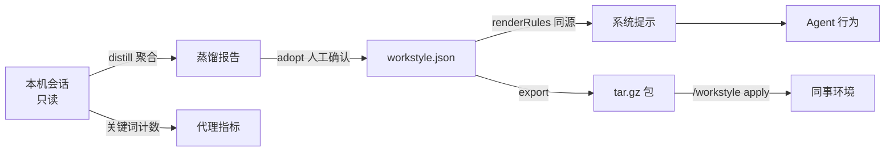

<div align="center">
  
  <h1>dsh-workstyle</h1>

  <p><b>把你的工作方式，打包成 Agent 的一条系统提示。</b></p>

  <p><sub>Work style as code — distill your working habits into rules, inject them into the system prompt, measure what changed, and ship the pack to a teammate with one command.</sub></p>

  <p>
    <a href="LICENSE"></a>
    <a href="package.json"></a>
    
  </p>
</div>


## 它解决什么

技能包解决「会不会」，本插件解决「像不像你」。

- **像你** — 把从真实会话里提炼的规则注入系统提示，模型按你的方式工作：先方案、证据优先、验证后才宣称完成、中文短句。
- **能复制** — 工作方式是一个 `workstyle.json` 包，可导出、可提交、可安装。同事装上就获得同一套工作方式。
- **可度量** — 只统计可复算的代理指标（先方案率、改完验证率、未验证宣称完成率），能看到「像不像」是否在变好，且不推断模型是否遵守规则。

## 安装

需要 DeepSeek Harness。装完**重启 Harness** 才会加载新插件。

从 GitHub 安装（推荐）：

```sh
dsh plugin --profile <你的 profile> add github:iannil/dsh-workstyle
```

> `<你的 profile>` 是 `~/.dsh/profiles/` 下的目录名（例如 `desktop`）。`dsh plugin` 把剩余参数原样转给该 profile 目录里的 pnpm。

本地开发安装（改代码即时生效）：

1. 将本目录放到任意路径，例如 `~/Code/zhurong/dsh-workstyle`。
2. 在 DeepSeek Harness 中安装该目录为插件（插件管理器 → 从本地目录安装）。
3. 重启后，侧边栏出现「工作方式」入口。

> 本地 link 安装的插件需要重启 Harness 才会加载新的 JS；装完看首屏状态带与页脚 `home v5` 即成功。

## 3 分钟上手

装完并重启后，按这四步确认「已经生效」，不必先读手册：

1. **打开侧边栏「工作方式」** — 看状态带是否有「注入中 N」和一串指纹。有指纹 = 规则已进系统提示。页脚应出现 `home v5`。
2. **新开一个对话**，说一句真实需求（例如「帮我给这个项目加登录」）。正常时应先给可评审方案（目标 / 改动点 / 验收），而不是直接改代码。
3. **回到面板点「载入预览」** — 核对真实注入文本；与指纹不一致就点刷新。首次打开会看到可关闭的「3 分钟上手」提示。
4. **改一条内置规则再回滚** — `#/rules` 编辑任意内置规则（写入本机覆盖层，包文件不动），指纹应立刻变化；再回 `#/distribute` 的「修订历史」点恢复，指纹回到改动之前。

## 核心能力

- **规则真的进系统提示** — 面板「载入预览」显示的就是系统提示里那一段：同一个 `renderRules()` 输出、`sha256` 前 12 位指纹、字符数，改一条规则指纹就变。
- **从本机会话蒸馏规则** — `workstyle_distill` 扫描已有会话，产出聚合报告与建议规则；你逐条采纳，不自动改你的提示。
- **便捷分享，手动导出仍是兜底** — 面板导出 `tar.gz` 后可一键下载，并把包名、规则 / 技能数与 `sha256` 复制给同事；对方把文件拖进「导入包」或运行 `/workstyle import <文件>`，先看清单与摘要，确认后才安装。链接安装走 `/workstyle import <https://…#sha256=…>`；公开市场的归档放在 GitHub Releases（由 CI 构建、仓库只存文本源），收件方始终手动确认，插件不上传任何本机数据。
- **三层作用域** — 全局 → 项目（`<cwd>/.dsh/workstyle.json`，跟着仓库走）→ 会话（一次性实验），后层覆盖前层。
- **只要可复算的指标** — 规则命中、先方案率、验证率、蒸馏覆盖，每个数字都写出分母与算法；**不出现遵守率或违反率**。
- **停用不等于删除** — 停用项在面板显示「被覆盖 · 会话」，只影响系统提示与技能候选，不写入导出包；被覆盖层移除的规则留下「已移除」墓碑，`恢复` 即让它重新参与组装。
- **市场包只读、改动落覆盖层** — 修改市场包（含默认包）规则写进 `state.json` 的 `rulePatches` / `ruleRemovals`，包目录保持原样；这些记录不在包目录里，升级或重新安装插件不会冲掉你的本地改动。
- **覆盖层与用户包写盘前留快照，20 份可回滚** — 只有覆盖层 `state.json` 与用户包清单在写入前快照到 `revisions/`（全新安装的第一次覆盖层写入会先建空 `state.json` 再快照，所以第一次改动也能回滚），每个文件保留最近 20 份；`#/distribute` 的「修订历史」可一键恢复。项目层与会话层文件不留快照，项目文件的历史由 git 负责。

## 它怎么工作



## 默认 Pack（市场）

`market/packs/fde-engineering/` 是市场里的默认包。全新安装时插件会把随包附带的本地快照复制到 `$DSH_HOME/workstyle/packs/fde-engineering/` 并设为当前包——不联网，装完即可用：

- **7 条规则** — 先方案后实现、证据优先、验证后才宣称完成、中文短句先结论、产物化、范围守卫、本地隐私。
- **40 个技能** — 来自 [iannil/skills](https://github.com/iannil/skills)，commit `b75ace6`，上游声明 MIT（见其 `package.json`），原样随包分发。

安装后的包按市场包处理：规则编辑写本机覆盖层，不直接改包目录；`#/market` 检测到新版本时显示「更新」，下载与替换都需要人工确认。删除该包后重启不会自动重装。

## Pack 格式

```json
{
  "id": "fde-engineering",
  "displayName": "FDE 工程工作方式",
  "version": "0.1.0",
  "rules": [{ "id": "plan-first", "title": "先方案后实现", "text": "…", "evidence": "…" }],
  "skills": { "dir": "skills", "source": "…", "license": "MIT" },
  "measures": [{ "id": "plan-first-rate", "title": "先方案率", "definition": "…" }]
}
```

Pack 放在 `$DSH_HOME/workstyle/packs/<id>/`；插件另带 `market/packs/<id>/` 作为默认包快照，首次启动时复制到用户目录。技能放 `skills/<name>/SKILL.md`。

## 面板、命令与 Agent 工具

面板分九个页面：`#/overview`（状态带、待办条、载入预览）、`#/pack` 与 `#/pack/<id>`（包列表 / 详情，含新建、目录 / 归档 / 链接三种导入、回收站恢复）、`#/market`（公开市场：浏览、预览、安装，检测到新版本时可更新）、`#/rules`（按作用域编辑 / 移除 / 恢复，每行标出将写入哪里）、`#/presets`（预设编辑器，规则白名单）、`#/skills`、`#/distill`、`#/metrics`、`#/distribute`（导出 + 修订历史回滚）。命令 `/workstyle status | apply | distill | adopt | undo | on | off | export | import`，另有 8 个 Agent 工具与 20 个 HTTP 路径 / 23 个处理函数（合并为 20 条 exact 路由）。安装导入包只发生在人确认之后：面板的「导入并应用 / 仅导入」，或命令的 `--yes`。

市场只在「打开 `#/market` 或主动安装」时联网；包源与贡献方式见 **[market/README.md](market/README.md)**。市场会检查新版本并显示「可更新」，但下载与替换必须人工确认，不会静默升级。

细节见 **[docs/USAGE.md](docs/USAGE.md)**。

## 隐私

- 默认离线：只读取本机已有会话记录。只有你打开 `#/market`、主动安装市场包或粘贴分享链接时，才访问 GitHub（市场）或对应下载地址；不上传任何本机数据。
- `distill` 只输出聚合统计（数量、比例、关键词计数），不保存 prompt 原文。
- 状态与报告存于 `$DSH_HOME/workstyle/`；导入的临时归档也在其中，15 分钟后懒清理。

## 开发

无运行时依赖，纯 ESM。Host 侧 `index.js` + `lib/`（`pack.js` 包模型、`distill.js` 蒸馏、`export.js` tar.gz 导出），Web 面板 `client.js`，清单 `cordis.patch.yml`。

```bash
node test/smoke.mjs             # 502 项：工具 / 路由 / 命令 / 启停 / 采纳与撤销 / 包生命周期 / 白名单 / 修订 / 导出与导入 tar 往返、sha256 与下载 / 市场降级
node test/panel-render.mjs      # 302 项：状态 / 搜索 / 筛选 / 启停 / 折叠 / 分发 / 分享与导入预览 / 市场页间距 / 构建标记、无营销文案
node test/multipage-render.mjs  #  97 项：多页路由渲染 / 导航 / 蒸馏 / 度量 / 缺失包恢复
node test/manage.mjs            #  37 项：快照与保留上限 / 恢复 / 写盘落点
node test/market.mjs            #  61 项：注册表校验 / 缓存 TTL / stale 回退 / 构建确定性 / 篡改检测
node test/bootstrap.mjs         #  14 项：默认包本地快照安装、幂等启动、删除后不重装、0.2.x 迁移、离线
```

市场包源在 `market/packs/<id>/`；本地校验与重建注册表：

```bash
node scripts/build-market.mjs --check   # CI 用的严格比对
node scripts/build-market.mjs --write   # 生成 .market-dist/ 与 registry.json
```

系统未装 Node 时可用 Harness 自带运行时：

```bash
ELECTRON_RUN_AS_NODE=1 "/Applications/DeepSeek Harness.app/Contents/MacOS/DeepSeek Harness" test/smoke.mjs
# 其余四套同理，把 test/smoke.mjs 换成 panel-render / multipage-render / manage / market
```

数据目录 `$DSH_HOME/workstyle/`：

| 路径 | 内容 |
| --- | --- |
| `state.json` | 当前包、`adoptions`、本机 `presets` / `templates`、覆盖层 `rulePatches` / `ruleRemovals` / `presetBlocked` |
| `overrides.json` | 本机启停 |
| `packs/<id>/` | 用户自建 / 导入的包（可写） |
| `market.json` | 市场目录缓存（10 分钟 TTL；离线时标 `stale`） |
| `trash/<id>-<时间戳>/` | 被删除的包，可恢复；不自动清理 |
| `revisions/` | 写盘前快照，每个文件保留 20 份 |
| `reports/` | 蒸馏报告 |
| `exports/` | 导出包 |
| `imports/` | 导入预览的临时归档（15 分钟懒清理） |
| `sessions/<id>.json` | 会话层作用域；不自动清理 |

## Contributing

欢迎 PR。设计稿与验证记录在 [`docs/`](docs/)（`docs/HOME-V5.md`、`docs/verification/`）；改完请跑上面四套测试。

## 许可

本插件 MIT，见 [LICENSE](LICENSE)。内置参考技能包来自 [iannil/skills](https://github.com/iannil/skills)（MIT，见 `market/packs/fde-engineering/workstyle.json` 的 `license` 字段）。
