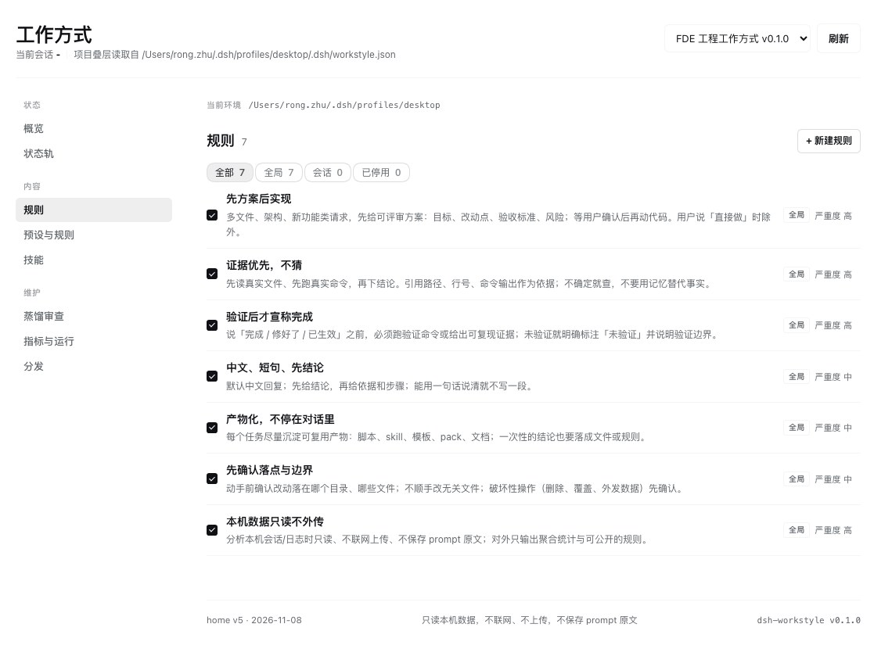
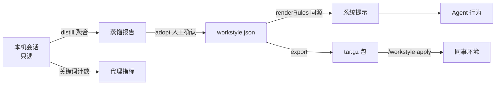

<div align="center">
  
  <h1>dsh-workstyle</h1>

  <p><b>让 DeepSeek Harness 的 Agent 像你一样工作。</b></p>

  <p><sub>把工作方式打包成可版本化的规则、技能与预设，按全局 / 项目 / 会话作用域注入系统提示，再用一个文件交给同事。</sub></p>

  <p>
    <a href="https://github.com/iannil/dsh-workstyle/blob/master/LICENSE"></a>
    <a href="https://github.com/iannil/dsh-workstyle/blob/master/package.json"></a>
    
    <a href="https://github.com/iannil/dsh-workstyle"></a>
    <a href="https://github.com/iannil/dsh-workstyle/commits/master"></a>
  </p>

  <p><a href="https://github.com/iannil/dsh-workstyle/blob/master/README.md">English</a> | 中文</p>
</div>



> ⭐ **如果这个项目对你有用，[点个 Star](https://github.com/iannil/dsh-workstyle)**，让更多 Harness 用户找到它。

## 它是什么

技能包解决「会不会」，本插件解决「像不像你」。

工作方式是一个可评审的 `workstyle.json` 包：规则、技能与预设。装上之后，规则按全局、项目或会话作用域进入 DeepSeek Harness 的系统提示；面板显示真实注入文本与 `sha256` 指纹，从本机会话蒸馏建议规则，并用可复算的代理指标说明发生了什么变化。

## 安装

需要 [DeepSeek Harness](https://github.com/deepseek-ai/deepseek-harness)。`<profile>` 是 `~/.dsh/profiles/` 下的目录名（例如 `desktop`）。

```sh
dsh plugin --profile <profile> add github:iannil/dsh-workstyle
```

装完重启 DeepSeek Harness，侧边栏出现 **工作方式** 入口。

本地开发时改用插件管理器的「从本地目录安装」；改完 JS 需重启才会加载。

## 3 分钟确认已生效

1. **打开工作方式** — 状态带显示注入规则数与指纹；页脚应出现 `home v5`。
2. **新开一个对话**，说一句真实需求（例如「帮我给这个项目加登录」）。正常时应先给可评审方案，而不是直接改代码。
3. **点「载入预览」** — 核对真实注入文本；与指纹不一致就刷新。
4. **改一条内置规则再回滚** — `#/rules` 编辑任意内置规则，指纹应立刻变化；再回 `#/distribute` 的「修订历史」点恢复，指纹回到改动之前。

## 核心能力

- **规则真的进系统提示** — 「载入预览」显示的就是系统提示里那一段：同一个 `renderRules()` 输出、`sha256` 前 12 位指纹、字符数；改一条规则指纹就变。
- **从本机会话蒸馏规则** — 扫描本机 Claude Code / Codex / DSH / Pi 会话，产出聚合报告与建议规则；逐条采纳，不自动改你的提示。
- **一个文件分享** — 导出带 `sha256` 的 `tar.gz`，或发 `#sha256=` 链接；对方先看清单与摘要，确认后才安装，不上传任何本机数据。
- **三层作用域** — 全局 → 项目（`<cwd>/.dsh/workstyle.json`，跟着仓库走）→ 会话（一次性实验），后层覆盖前层。
- **只要可复算的指标** — 先方案率、验证率、蒸馏覆盖；每个数字都写出分母与算法，**不出现遵守率或违反率**。
- **停用不等于删除** — 停用项显示为「被覆盖」，只影响系统提示与技能候选，不写入导出包；被移除的规则留下墓碑，`恢复` 即重新参与组装。
- **市场包只读、改动落覆盖层** — 修改市场包（含默认包）的规则写进 `state.json` 的 `rulePatches` / `ruleRemovals`，包目录保持原样；升级或重装不会冲掉本地改动。

## 它怎么工作



## Agent 集成

插件注册 8 个 Agent 工具：

| 工具 | 作用 |
| --- | --- |
| `workstyle_status` | 当前包、作用域、注入指纹 |
| `workstyle_list` | 列出规则、预设与技能 |
| `workstyle_apply` | 启用某个包 |
| `workstyle_distill` | 扫描本机会话并写报告 |
| `workstyle_evidence` | 读取最新蒸馏报告 |
| `workstyle_adopt` | 采纳一条建议规则 |
| `workstyle_toggle` | 启用 / 停用一条规则 |
| `workstyle_export` | 把当前包导出为 `tar.gz` |

人工命令：`/workstyle status | apply | distill | adopt | undo | on | off | export | import`。面板分九个页面：概览、包、市场、规则、预设、技能、蒸馏、指标、分发；导入只在人确认预览之后发生。

## 默认包与市场

`market/packs/fde-engineering/` 是随插件附带的默认包：**7 条规则**（先方案后实现、证据优先、验证后才宣称完成、中文短句先结论、产物化、范围守卫、本地隐私）与来自 [iannil/skills](https://github.com/iannil/skills) 的 **40 个技能**（commit `b75ace6`，MIT）。首次启动时插件把随包快照复制到 `$DSH_HOME/workstyle/packs/fde-engineering/` 并设为当前包，不联网。

`#/market` 读取 `market/registry.json` 的公开包；归档由 CI 构建、放在 GitHub Releases，仓库只存文本源。检测到新版本会提示「可更新」，但下载与替换必须人工确认。提交包见 [market/README.md](https://github.com/iannil/dsh-workstyle/blob/master/market/README.md)。

## Pack 格式

```json
{
  "id": "fde-engineering",
  "displayName": "FDE 工程工作方式",
  "version": "0.1.0",
  "rules": [{ "id": "plan-first", "title": "先方案后实现", "text": "…", "evidence": "…" }],
  "skills": { "dir": "skills", "source": "…", "license": "MIT" },
  "measures": [{ "id": "plan-first-rate", "title": "先方案率", "definition": "…" }]
}
```

Pack 放在 `$DSH_HOME/workstyle/packs/<id>/`；技能放 `skills/<name>/SKILL.md`。随插件附带的默认包快照在 `market/packs/<id>/`。

## 隐私

- **默认离线** — 只读取本机已有会话记录；只有打开 `#/market`、安装市场包或粘贴分享链接时才访问网络。
- **只输出聚合** — 蒸馏只写数量、比例与关键词计数，不保存也不上传 prompt 原文。
- **数据在本机** — 状态与报告存于 `$DSH_HOME/workstyle/`；导入的临时归档 15 分钟后懒清理。

## 开发

无运行时依赖，纯 ESM。Host 侧 `index.js` + `lib/`（`pack.js` 包模型、`distill.js` 蒸馏、`export.js` tar.gz 导出），Web 面板 `client.js`，清单 `cordis.patch.yml`。

```sh
node test/smoke.mjs            # 502 项：工具 / 路由 / 命令 / 启停 / 采纳与撤销 / 包生命周期 / 白名单 / 修订 / tar 往返 / 市场降级
node test/panel-render.mjs     # 302 项：状态 / 搜索 / 筛选 / 启停 / 折叠 / 分发 / 分享与导入预览 / 市场页间距 / 构建标记
node test/multipage-render.mjs #  97 项：多页路由渲染 / 导航 / 蒸馏 / 度量 / 缺失包恢复
node test/manage.mjs           #  37 项：快照与保留上限 / 恢复 / 写盘落点
node test/market.mjs           #  61 项：注册表校验 / 缓存 TTL / stale 回退 / 构建确定性 / 篡改检测
node test/bootstrap.mjs        #  14 项：默认包本地快照安装、幂等启动、删除后不重装、0.2.x 迁移
```

市场包源在 `market/packs/<id>/`；本地校验与重建注册表：

```sh
node scripts/build-market.mjs --check   # CI 用的严格比对
node scripts/build-market.mjs --write   # 生成 .market-dist/ 与 registry.json
```

数据目录与内部细节见 [docs/USAGE.md](https://github.com/iannil/dsh-workstyle/blob/master/docs/USAGE.md)；设计稿与验证记录见 [docs/](https://github.com/iannil/dsh-workstyle/tree/master/docs)。

## Contributing

欢迎 PR。改完请跑上面的测试；设计稿与验证记录在 [`docs/`](https://github.com/iannil/dsh-workstyle/tree/master/docs)。

## 许可

本插件 MIT，见 [LICENSE](https://github.com/iannil/dsh-workstyle/blob/master/LICENSE)。内置参考技能包来自 [iannil/skills](https://github.com/iannil/skills)（MIT，见 `market/packs/fde-engineering/workstyle.json` 的 `license` 字段）。

## Star History

[](https://star-history.com/#iannil/dsh-workstyle&Date)
